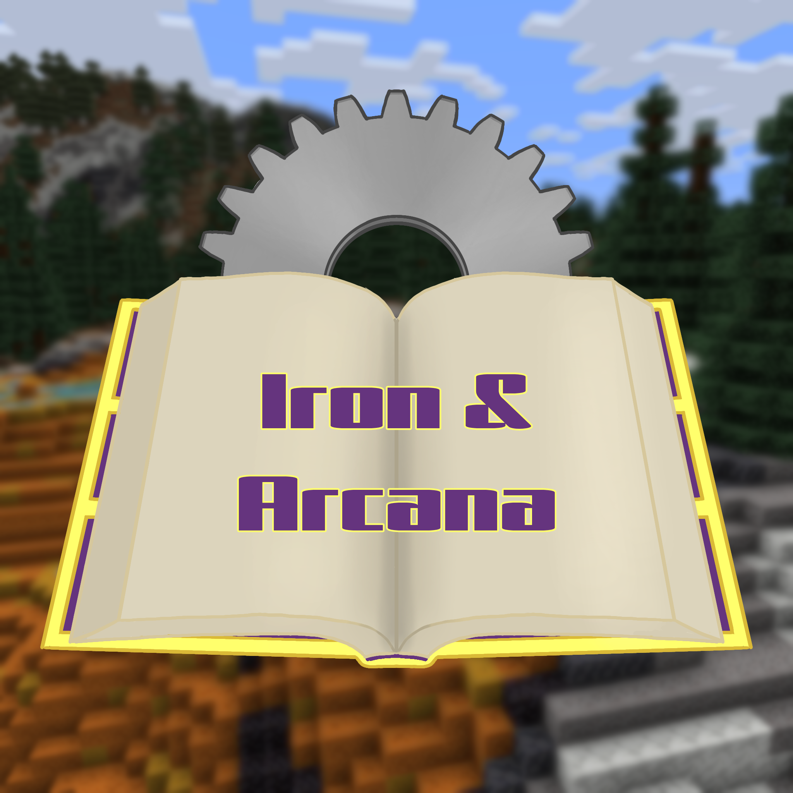

# Iron & Arcana

**Minecraft 1.20.1 · Forge 47.4.10 · 117 mods**

A colony-building, engineering and exploration pack for a small friend server.
Colonies and factories first, magic second, no automation shortcuts.

Not published on Modrinth or CurseForge — built and distributed from this
repository.

<br clear="right">

## The pack

| Pillar | Mods |
|---|---|
| Colony | MineColonies, Structurize, Domum Ornamentum, Stylecolonies, TownTalk |
| Engineering | Create + Crafts & Additions, Slice & Dice, Steam 'n' Rails |
| Industry | Immersive Engineering, Immersive Petroleum |
| Gear | Tinkers' Construct + Compatibility, Delight, Jewelry, Levelling, Things, Thinking, Reforged |
| Magic | Ars Nouveau (+ Ars Creo), Botania |
| Exploration | Twilight Forest, The Aether (+ Deep Aether, Treasure Reforging), Alex's Caves, Terralith, YUNG's structures, Dungeons and Taverns |
| Combat | Better Combat, Bosses of Mass Destruction, Illager Invasion, Creeper Overhaul, Friends&Foes, Naturalist |
| Redstone | Project Red — timers, counters, sequencers, latches, bundled cable, and circuits you design yourself |
| Food & farming | Farmer's Delight, Serene Seasons (8-day seasons) |
| Building | Chipped, Supplementaries + Amendments, Macaw's Bridges/Doors/Roofs/Windows |
| Storage | Sophisticated Backpacks (+ Create integration) |
| Quality of life | JEI, JER, Jade, Waystones, Xaero's Minimap & World Map, Lootr, Open Parties & Claims, GraveStone, AppleSkin, Clumps |
| Performance | Embeddium, FerriteCore, ModernFix, Noisium, Clumps |

Design rules worth knowing before you play:

- **Tinkers' Construct is the only gear system.** Silent Gear was removed in 2.0.
- **One recipe viewer: JEI.** Every major mod here ships JEI integration, so
  Tinkers' casting, Create's processing and JER's ore distribution all render
  natively. EMI was trialled and removed.
- **Automation shortcuts are disabled.** Sophisticated Backpacks is present, but
  every stack upgrade, both Infinity upgrades, and the feeding, inception,
  everlasting, auto-cooking and alchemy upgrades are turned off. Carrying more
  than one backpack applies Slowness.
- **Storage is backpacks, not a second system.** Project Red's own backpacks are
  disabled, as is its gem armour — Tinkers' stays the gear system. Its gem
  *tools* are craftable.
- **No flight/airship mod.**

See [SKIPPED.md](SKIPPED.md) for what was considered and rejected, and why.

## Installing the client

Every [release](https://github.com/wrenchInTheWorks/iron-and-arcana/releases/latest)
carries two files. Pick the one that matches your launcher:

| File | For | Size |
|---|---|---|
| `Iron.Arcana-<version>.mrpack` | Modrinth App, Prism Launcher, ATLauncher | ~170 MB |
| `Iron.Arcana-<version>.zip` | the CurseForge launcher | ~400 MB |

Either way the launcher fetches Forge 47.4.10 and **Java 17** itself.

> Import as a **new instance** rather than over an old one. Reusing an instance
> can leave stale jars behind, which causes mod-mismatch kicks or launch crashes.

### Modrinth App / Prism Launcher — the `.mrpack`

Create an instance *from file* and pick the `.mrpack`. Nothing else to do.

### CurseForge launcher — the `.zip`

**Minecraft → Create Custom Profile → Import**, then pick the `.zip`.

CurseForge will show a warning that the pack contains mods that did not come
from CurseForge, and make you approve them before it will install. **That is
expected — approve it.** The pack is built with packwiz and sources 106 of its
117 mods from Modrinth, so only 11 are CurseForge-hosted and resolve as normal
manifest entries; the other 101 client-side jars are bundled inside the `.zip`
itself. CurseForge cannot verify what it did not serve, so it asks. That is also
why the `.zip` is more than twice the size of the `.mrpack`.

The `.zip` is the less-tested of the two routes — the pack is developed and
played on the `.mrpack`. If a launcher-side problem appears, try that one.

Both files are snapshots, so they go stale whenever the pack changes. The
server self-updates from this repo on every restart; clients do not.

### Auto-updating clients (recommended)

Instead of re-importing an `.mrpack` after every change, point the client at
this repo so it syncs on launch — the same mechanism the server uses. Requires
**Prism Launcher** or MultiMC (they support pre-launch commands).

1. Create the instance once from the `.mrpack` as above.
2. Download `packwiz-installer-bootstrap.jar` from
   [packwiz-installer-bootstrap releases](https://github.com/packwiz/packwiz-installer-bootstrap/releases)
   and put it in the instance's `.minecraft` folder.
3. Edit Instance → **Settings → Custom Commands** → tick *Custom Commands*, and
   set **Pre-launch command**:

   ```
   "$INST_JAVA" -jar packwiz-installer-bootstrap.jar https://raw.githubusercontent.com/wrenchInTheWorks/iron-and-arcana/main/pack.toml
   ```

Every launch then adds, removes and updates mods to match the repo — no more
mod-mismatch kicks after a pack change, and no re-importing.

> Your own settings are safe: the pack ships no `options.txt`, so the installer
> never touches your video, control or resource-pack choices.

The Modrinth App does not reliably expose pre-launch hooks; on that launcher,
re-import the `.mrpack` when the pack changes.

### Shaders (optional, not bundled)

Install **Oculus** alongside the pack — it works with Embeddium, which is
already included. Complementary Reimagined suits the pack's lighting best;
BSL and Sildur's Vibrant are good lighter alternatives.

## Joining the server

The server is whitelisted, but whitelisting is **self-service through Discord**
rather than a request to an admin. `/ia whitelist <your Java username>` in the
guild resolves the name against Mojang, adds it over RCON and replies privately.
One Minecraft account per Discord account; running it again with a different
name swaps which one is whitelisted.

That is handled by **Wrench's Toolkit**, a self-hosted Discord bot that also
bridges in-game chat, joins, leaves and deaths into Discord, and takes the
scheduled off-host backups. Its repo is private for now, so it is not a
dependency you can pick up — and it does not need to be. **The pack ships no
Discord mod**: the bridge works by tailing the server log and sending RCON, so
the pack stays fully playable with no bot running.

## Running the server

Self-hosted with Docker. See **[server/README.md](server/README.md)** for setup,
updating, backups and the operational gotchas.

```bash
cd server
cp .env.example .env     # set WHITELIST, OPS, RCON_PASSWORD
docker compose up -d
```

The server installs the pack itself from this repo via `PACKWIZ_URL`, so
`docker compose restart` *is* the update.

## Repository layout

| Path | Purpose |
|---|---|
| `mods/*.pw.toml` | one packwiz metadata file per mod |
| `config/` | mod configs shipped with the pack — **edit here, not in the container** |
| `defaultconfigs/` | Forge server-scoped configs; seeds **new** worlds only |
| `server/` | Docker deployment |
| `docs/` | v1 mod inventory and historical notes |
| `CLAUDE.md` | maintainer handover — read this before changing the pack |

## Maintenance

```bash
packwiz refresh            # after any pack change
packwiz modrinth export    # catches mods that cannot be distributed
```

CI builds on every push and cuts a GitHub Release only when `pack.toml`'s
version changes.
